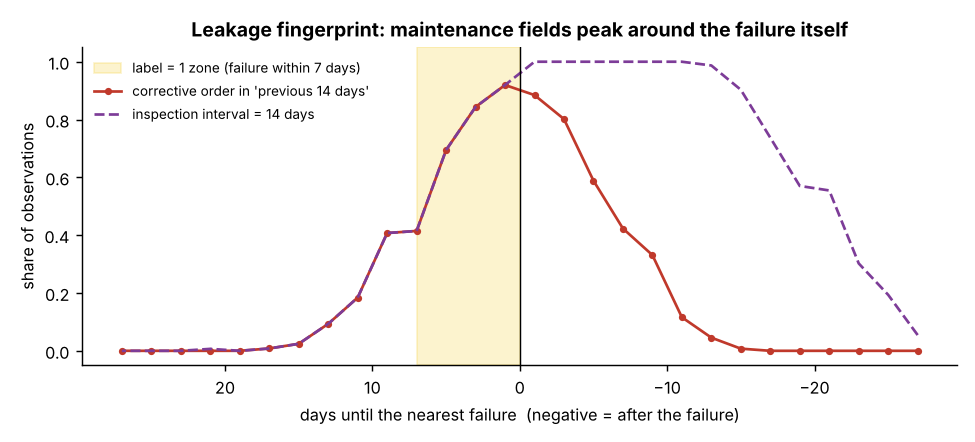
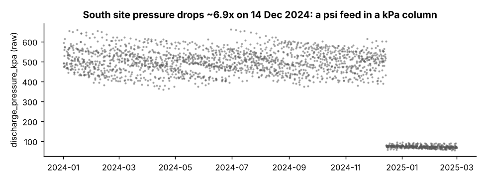
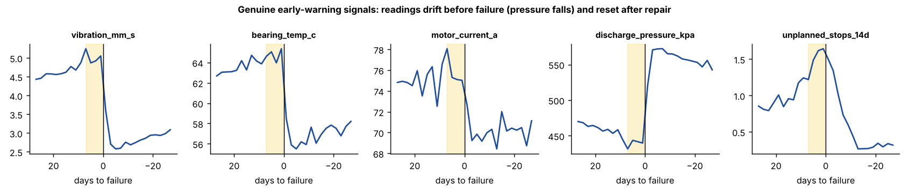
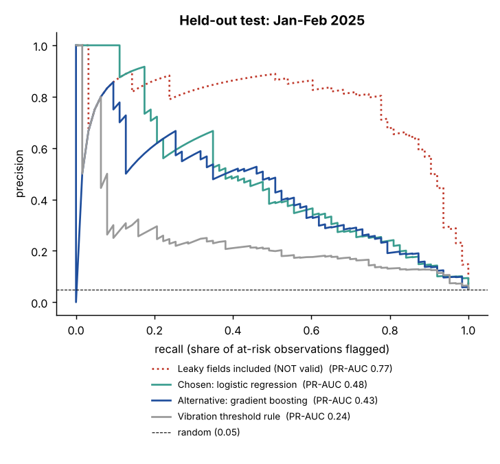
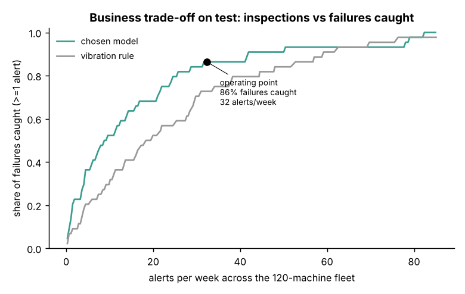
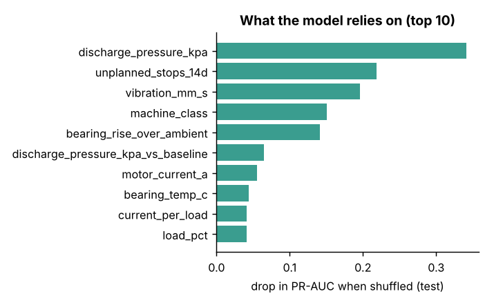

# Machine Failure Early-Warning: Assessment

Can we flag machine observations where a failure is likely within the next 7 days, early enough to inspect and with a manageable number of false alarms?

> **Interactive findings page: [murfroggies.github.io/machine-failure-early-warning/report](https://murfroggies.github.io/machine-failure-early-warning/report/)**. It has a live slider for the alerts vs failures-caught trade-off. Source: `report/index.html`, rebuilt with `python report/build_report.py`.

**Short answer:** there is a real, usable signal in the sensor data, but the two maintenance fields that make the model look excellent are leaking the answer. With them removed, the honest model is **good enough for a supervised pilot (shadow mode), not for unsupervised deployment.**

---

## 1. Summary for business stakeholders

| What we measured (held-out Jan to Feb 2025, never used for building) | Result |
|---|---|
| Failures caught (at least one alert in the 7 days before) | **38 of 44 (86%)**, 95% range 76% to 95% |
| Alerts raised across the 120-machine fleet | **~32 per week** (about 1.2 per machine per month) |
| Share of alerts that were real | **~1 in 5 (22%)**, 95% range 17% to 28% |
| Typical warning before failure | **~4 days** (median) |
| Simple rule "alert when vibration is high", same alert budget | catches only 32 of 44 (73%) |

**What this means**
- **Value:** the model catches about 6 more failures in 2 months than a vibration rule, for the same inspection effort.
- **Cost:** about 4 of every 5 alerts lead to an inspection that finds nothing urgent. Whether ~32 inspections a week is affordable is an operations decision. The threshold can be moved (see figure 5).
- **Misses:** 6 failures gave almost no warning in the sensors. No model on this data will catch those.

**Recommendation:** run a **3-month shadow pilot**: model scores every observation, planners see the alerts, decisions stay with engineers. Go-live only after the data questions in section 4 are answered and the pilot confirms the catch rate and alert volume.

---

## 2. Key findings (technical)

### Finding 1: two fields leak the target and must not be used
`corrective_orders_14d` and `inspection_interval_days` look like the best predictors (with them, PR-AUC jumps from 0.48 to 0.77). But their timing does not match their description:



- A field that counts orders in the **previous** 14 days should only rise **after** a failure. Instead it rises symmetrically, peaking right at the failure, and is ~0 more than 14 days before.
- `inspection_interval_days` is identical to it before every failure (switches 30 to 14 days at the same moment) and stays at 14 for ~3 weeks after: it is a **reaction** to the failure.
- Most likely cause: orders are dated by the repair/failure date, or the field was rebuilt from the work-order system after the fact. At scoring time the information would not exist.
- **Decision:** excluded. The leaky model is kept in the results only to show how misleading it would be.

### Finding 2: three data quality problems, one of which silently breaks the model


| Issue | Rows | Fix |
|---|---|---|
| South site pressure reported in **psi** from 14 Dec 2024 (all 24 South machines, values ~6.9x too low) | 393 | Multiply by 6.895. Restores the exact prior distribution. |
| Exact duplicate observations (different `record_id`, identical everything else) | 80 | Dropped |
| `vibration_mm_s = -999` sentinel | 10 | Set to missing |
| `machine_class = "unknown"` on single rows of 15 machines | 15 | Filled with the machine's own class |
| Last 7 days: failures after the data extract are not visible (positive rate falls to 1.7%) | 171 | Excluded from training and evaluation |

Without the pressure fix, test PR-AUC falls from **0.48 to 0.08**. The unit change lands exactly in the test period, so a random split would have hidden it.

### Finding 3: the real signal is gradual drift that resets after repair


Vibration, bearing temperature and motor current rise, and discharge pressure falls, over the weeks before a failure, then reset after the repair. That is the pattern a maintenance engineer would expect, which gives confidence the model is learning something physical.

### Finding 4: model performance on the untouched test period



- Logistic regression and gradient boosting perform within noise of each other. **Logistic regression was chosen**: it needed fewer alerts for the same catch rate on validation, and it is easier to explain and monitor.
- Most important inputs: discharge pressure, unplanned stops, vibration, machine class, bearing temperature above ambient.



---

## 3. How I approached it

| What I did | Why |
|---|---|
| **Used only past information** for each prediction | In real use, each check is scored the moment it is recorded. The future isn't known yet. |
| **Trained on older data, tested on newer data**, with a 7-day gap | Real use always predicts the future. The gap stops the 7-day answer leaking into training. |
| **Compared 3 approaches**: a simple vibration rule, logistic regression, gradient boosting | The rule is the no-ML baseline the models must beat. |
| **Picked the alert level on older data, then locked it** before the final test | So the final test is a fair, untouched check. |
| **Judged success by failures caught vs alerts per week** | That is what operations will feel. Accuracy is meaningless when 95% of checks are "no". |

**Why logistic regression:** on the practice data it needed the fewest alerts to catch 80% of failures (28 a week vs 32 for gradient boosting). Their overall scores were within noise of each other, so the simpler, easier-to-explain model won.

**Inputs the model uses:** the sensor readings, plus each sensor compared with that machine's own recent normal, the change since the last check, and flags for missing readings.

---

## 4. Assumptions I made

Each one is a judgement call. If any turns out wrong, the result could change. Full detail in [docs/ASSUMPTIONS.md](docs/ASSUMPTIONS.md).

| # | I assumed | Why | What I did | To confirm with data owner |
|---|---|---|---|---|
| 1 | **Corrective orders and inspection interval are recorded after a failure** | They peak at the failure itself, not before it | Excluded both | Which date is stored on an order? Is the 14-day count computed live? |
| 2 | **Unplanned stops are logged in real time** | They rise gradually over 3 weeks before a failure, like a real warning | Kept it | Is the failure itself counted as a stop? |
| 3 | **South pressure switched to psi on 14 Dec 2024** | All 24 South machines drop ~6.9x on one day; x6.895 restores the old range | Converted back to kPa | Confirm the feed change |
| 4 | **Each check is scored the moment it is recorded** | The brief says so | Features use only current and earlier checks | Are any fields filled in later by a batch job? |
| 5 | **The same 120 machines will be scored in production** | It is one fleet | Split by time, not by machine | |
| 6 | **The last 7 days' labels are incomplete** | Failures after the extract are unknown; positive rate falls to 1.7% | Excluded those 171 rows | |
| 7 | **Duplicate rows are double-loaded records** | Identical in every field except record ID | Kept one copy | Why are records duplicated? |
| 8 | **-999 is a sensor error code** | Vibration can't be negative | Set to missing | Are there other error codes? |
| 9 | **A machine's class never changes** | Each "unknown" sits among one class on all other rows | Filled from the same machine | |
| 10 | **A missing reading may itself be a warning sign** | Missing vibration rows fail slightly more often (7.8%) | Kept rows, added a flag | |
| 11 | **One alert in the 7 days before a failure is enough** | It is enough to send a technician | Measured "failures caught" per failure | |
| 12 | **80% catch rate is a reasonable starting target** | Misses cost more than inspections, but alerts must stay manageable | Set the threshold on validation data | Real cost of a missed failure vs an inspection |

---

## 5. How to run

Requires Python 3.10+.

```bash
git clone <this repo>
cd machine-failure-early-warning
python -m venv .venv && source .venv/bin/activate   # Windows: .venv\Scripts\activate
pip install -r requirements.txt
python run_analysis.py
python report/build_report.py   # optional: rebuilds the interactive findings page
```

Runs in about 1 to 2 minutes and regenerates everything in `outputs/`:
- `metrics.json`: all numbers quoted in this README
- `validation_model_comparison.csv`: walk-forward comparison of all candidates
- `figures/`: the charts above

The data file is included at `data/machine_observations.csv`. Random seeds are fixed, so results are identical on re-run.

### Repository layout
```
run_analysis.py          end-to-end pipeline (clean -> features -> validate -> test -> figures)
src/data.py              loading, cleaning, failure-event reconstruction
src/features.py          past-only feature engineering, feature sets, excluded fields
src/models.py            candidate models
src/evaluate.py          observation- and event-level metrics, machine bootstrap
docs/ASSUMPTIONS.md      assumptions and questions for the data owner
docs/PRESENTATION.md     10-minute talk track
report/                  interactive findings page (index.html) and the script that builds it
outputs/                 generated results
```

---

## 6. Limitations and next steps

**Limitations**
- Test window is 2 months with 44 failures; ranges above are wide. South had only 3 test failures.
- Precision is counted per observation; consecutive alerts on one machine are often the same case, so the real inspection load is somewhat lower than ~32/week.
- Lead time is capped by the 7-day label definition.
- Failure times are estimated from the label (within ~4 days on average).

**Before deployment**
1. Resolve the data questions in section 4.
2. Shadow pilot for ~3 months; track failures caught, alert volume, and what inspections actually found.
3. Agree the threshold with operations using a cost per missed failure vs cost per inspection.
4. Add input monitoring (units, ranges, missing rates) so a change like the psi switch raises an alarm instead of silently degrading the model.
5. Then try: machine-level alert de-duplication, longer history features, and a cost-based threshold.
